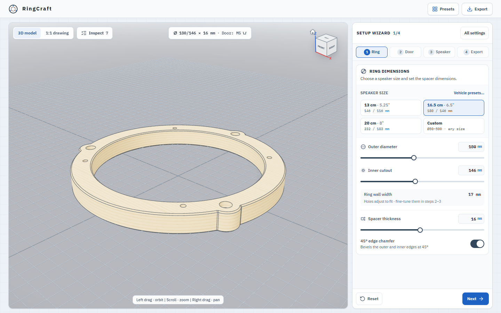

# RingCraft


**[Открыть RingCraft · Open live demo](https://ringcraft-audio.vercel.app/)**

Параметрический онлайн-конструктор проставочных колец и переходных рамок для автомобильных динамиков. Задайте размеры и крепёж, проверьте модель в 3D и скачайте чертёж для фрезеровки или модель для 3D-печати.

Browser-based CAD for car speaker spacer rings and adapters. Preview your design in 3D or as a 2D drawing and export DXF, STL, SVG, or PNG. The interface is available in English and Russian.

## Возможности

- Пошаговый мастер параметров кольца с проверкой ограничений.
- 3D-вид (three.js) и 2D-чертёж с видовым кубом.
- Экспорт: DXF, STL, SVG, PNG-снимок вида.
- Пресеты и сохранение параметров в браузере.
- Русский и английский интерфейсы с автоматическим выбором по языковым настройкам браузера.



Параметры модели и пользовательские пресеты хранятся локально в браузере. На размещённом сайте Vercel Web Analytics собирает статистику посещений без cookies.

## Запуск

Для локального запуска установите Bun 1.3.x и Node.js 22.12 или новее.

```sh
bun install --frozen-lockfile
bun run dev
```

Dev-сервер откроется на http://localhost:3000.

## Команды

| Команда             | Что делает                                                                    |
| ------------------- | ----------------------------------------------------------------------------- |
| `bun test`          | Юнит-тесты (`src/core`)                                                       |
| `bun run typecheck` | Проверка типов TypeScript                                                     |
| `bun run lint`      | ESLint                                                                        |
| `bun run format`    | Prettier (`format:check` только проверяет)                                    |
| `bun run build`     | Production-сборка в `dist`                                                    |
| `bun run preview`   | Локальный просмотр сборки (с теми же заголовками безопасности, что и в проде) |
| `bun run e2e`       | Сквозные тесты Playwright против `vite preview`                               |

Перед первым запуском e2e установите браузер: `bunx playwright install chromium`.

## Структура

- `src/core` — вся логика (геометрия, ограничения, экспорт, хранилище) и её тесты.
- `src/components` — React-компоненты интерфейса.
- `e2e` — сквозные тесты Playwright.
- `vercel.json` — конфигурация деплоя и заголовки безопасности.

## Деплой

Деплой через Vercel Git Integration. Шаги для владельца:

1. vercel.com → Add New Project → импортируйте `MichailLis/RingCraft` (Framework определится как Vite, остальное берётся из `vercel.json`).
2. При смене основного домена задайте `VITE_SITE_URL` для production и preview. Из него сборка формирует канонический адрес, ссылки в карточках соцсетей, `robots.txt` и `sitemap.xml`. По умолчанию используется `https://ringcraft-audio.vercel.app`.
3. Analytics → Enable Web Analytics.
4. После первого деплоя откройте сайт, проверьте экспорт и превью ссылки.

Изменения в `main` проходят через pull request с проверками `check` и `e2e`. Перед слиянием проверьте preview-деплой ветки на Vercel.

- Vercel Web Analytics отключена в локальной разработке, в `vite preview` и в e2e; активна на preview-деплоях Vercel и в production.
- Vercel Toolbar на preview-деплоях блокируется CSP (скрипт с vercel.live): отключите toolbar в настройках проекта или игнорируйте; production не затронут.
- Сохранённые в браузере пресеты привязаны к адресу сайта: при переезде на новый домен пользователи начинают с чистого листа.

### Заголовки безопасности

`vercel.json` задаёт CSP (`default-src 'self'`, без внешних источников), `X-Frame-Options: DENY`, `nosniff`, `Referrer-Policy` и `Permissions-Policy`. `vite.config.ts` читает эти же заголовки из `vercel.json` и применяет их к `vite preview`, поэтому e2e проверяет CSP. К dev-серверу они не применяются (HMR требует inline/eval). Исключения из CSP: `style-src 'unsafe-inline'` (inline-стили React и three.js), `img-src data: blob:` (PNG-снимок и текстуры), `worker-src blob:`.

## Лицензия

MIT, см. [LICENSE](LICENSE).
